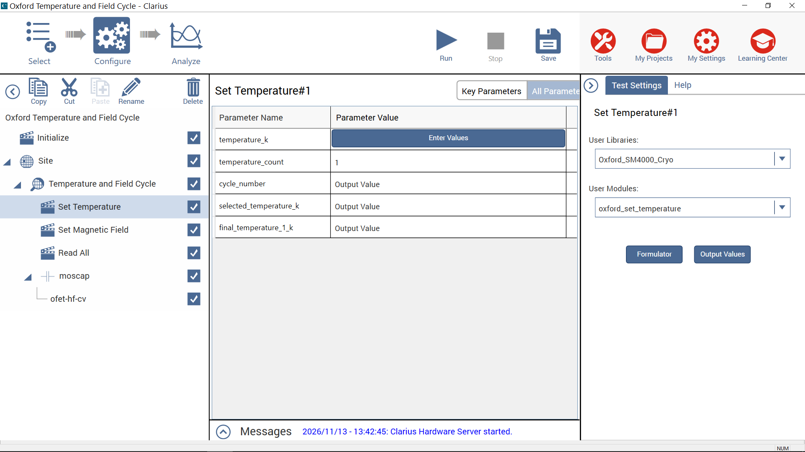

# Oxford SM4000 Cryostat Control for Keithley 4200A-SCS

A native KULT C library for controlling an Oxford Instruments SM4000 cryostat
from Keithley 4200A-SCS Clarius projects.

The library exposes Clarius Custom Action modules for temperature control,
magnetic-field control, cryogen-level monitoring, and complete Oxford system
readback. It is designed for long-running Site/Subsite measurement cycles and
does not require Python, VISA, or an external control process.

> [!IMPORTANT]
> Cryostat and superconducting-magnet operation can take substantial time and
> changes physical equipment state. Commission each module with the hardware
> attended before using it in an unattended measurement cycle.

## Supported system

| Device | Function | ISOBUS address |
|---|---|---:|
| Oxford ITC503 | Temperature control | 1 |
| Oxford IPS120 | Magnet power supply | 2 |
| Oxford Lambda controller | Pressure, temperature, and valve readback | 3 |
| Oxford ILM200 | Helium and nitrogen level monitoring | 5 |

The Oxford ISOBUS interface is connected to **COM1** of the 4200A-SCS. The
library communicates directly through the Windows serial API using the Oxford
9600-baud, 8-N-2 protocol and Q2 response mode.

## Main Clarius workflow

The primary project recipe is a single Temperature-and-Field cycling Subsite:

```text
Oxford Temperature and Field Cycle
|-- Initialize
`-- Site
    `-- Temperature and Field Cycle [Subsite: Cycle]
        |-- Set Temperature
        |-- Set Magnetic Field
        |-- Read All
        `-- Device / Keithley measurement
```

For every Subsite cycle, Clarius selects the corresponding row from the
temperature and magnetic-field arrays. The two schedules therefore describe
paired environment points rather than independent nested loops.

| Cycle | `temperature_k` | `field_t` |
|---:|---:|---:|
| 1 | 4.2 K | 0.0 T |
| 2 | 4.2 K | 1.0 T |
| 3 | 10.0 K | 0.0 T |
| 4 | 10.0 K | 1.0 T |

Each setter reads the current Clarius cycle through `GetKiteCycle()`. Outside a
cycling Subsite, Clarius reports cycle 1, so the same modules can also be used
normally with a one-element input array.



## Public modules

All public modules return `int`: `0` indicates success and a negative value
indicates that the action did not complete.

| Module | Purpose |
|---|---|
| `oxford_initialize` | Checks all Oxford devices and applies the reference IPS field sweep rate. |
| `oxford_set_temperature` | Selects the current temperature row, configures the ITC503, and waits for the reference stability criterion. |
| `oxford_set_magnetic_field` | Selects the current field row and completes the reference persistent-field procedure. |
| `oxford_read_all` | Returns the combined ILM, ITC, Lambda, and IPS measurement snapshot. |
| `oxford_read_itc` | Returns the complete ITC503 state and temperature snapshot. |
| `oxford_read_ilm` | Returns the complete ILM200 state and level snapshot. |
| `oxford_read_lambda` | Returns the Lambda controller state and readings. |
| `oxford_read_ips` | Returns the complete IPS120 state and magnet snapshot. |
| `oxford_set_active` | Places the ILM probe into the reference active mode. |
| `oxford_set_standby` | Applies the reference standby sequence and requests zero magnetic field. |

The detailed parameter and output tables are in the
[Public API and Clarius Cycle Guide](docs/API_specification/Oxford_KULT_Public_API.pdf).
